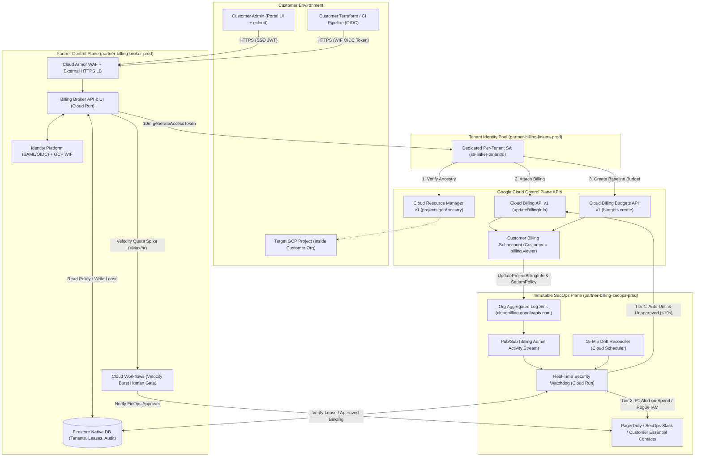
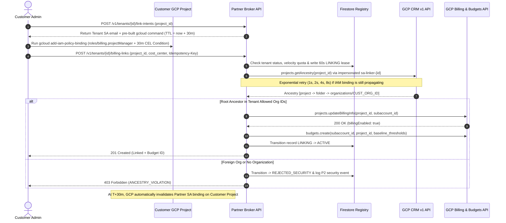
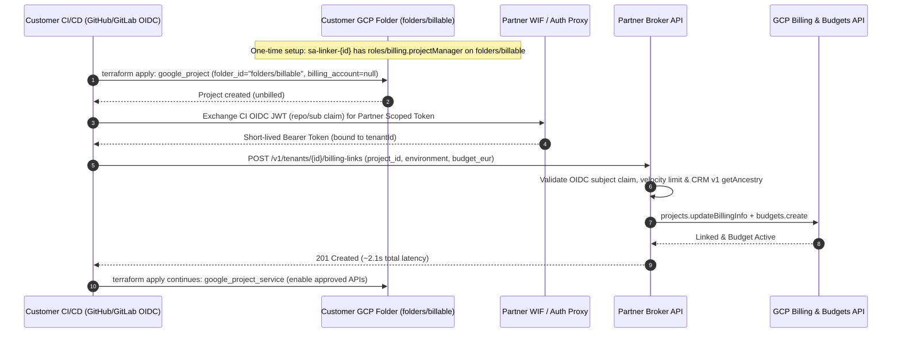
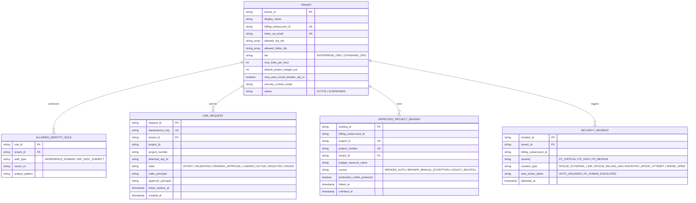
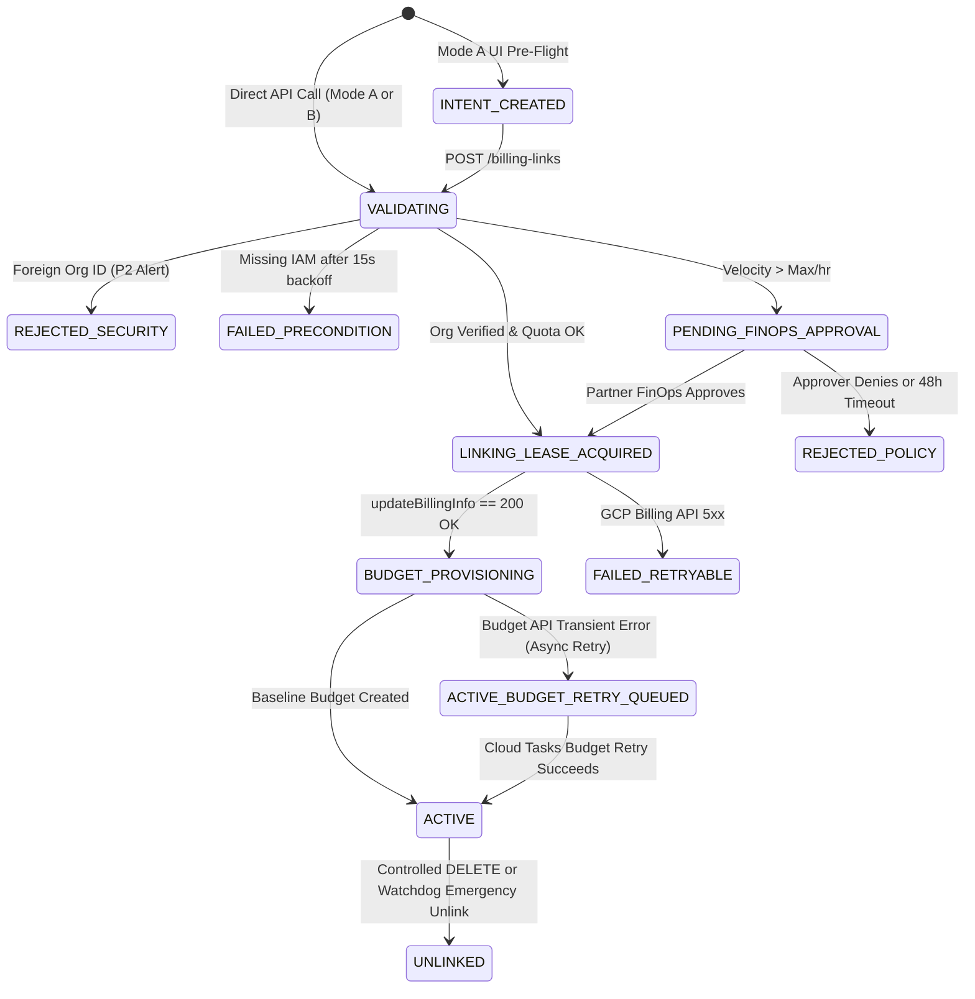

# High-Level Design (HLD): Zero-Standing-Privilege Billing Account Linking Platform ("Billing Broker")

| Metadata | Details |
| :--- | :--- |
| **Document ID** | `HLD-FINOPS-SEC-001` |
| **Version** | `v1.1` (Updated per Partner Validation — Dual-Mode Architecture) |
| **Date** | `2026-11-19` |
| **Target Audience** | Partner Cloud Architecture, SecOps, FinOps Engineering & Platform Teams |
| **Source Context** | [Contexto.pdf](file:///Users/carmona/Agy/Caso%20Billling%20Admin/Contexto.pdf) · [CorreoMitigacionRiesgo.pdf](file:///Users/carmona/Agy/Caso%20Billling%20Admin/CorreoMitigacionRiesgo.pdf) · [PropuestaPartner.pdf](file:///Users/carmona/Agy/Caso%20Billling%20Admin/PropuestaPartner.pdf) · [risk_analysis_and_email_audit.md](file:///Users/carmona/Agy/Caso%20Billling%20Admin/risk_analysis_and_email_audit.md) |

---

## 1. Executive Summary & Architectural Principles

### 1.1 Purpose
Recent cloud-billing hijack incidents ("LLMjacking") have demonstrated that compromising a single principal holding `roles/billing.admin` or `roles/billing.user` enables attackers to attach dozens or hundreds of external **Made-for-Abuse** Google Cloud projects to a corporate or Partner-managed Billing Account. Because external projects reside outside the customer's Google Cloud Organization, they bypass all customer Organization Policies and multiply per-project AI/GPU quotas horizontally—burning €100k–€500k+ in hours with **0% credit recovery** under Google's Shared Responsibility Model.

This High-Level Design (HLD) specifies an industrialized, multi-tenant **Partner Billing Broker Platform** that **eliminates all standing `roles/billing.admin` and `roles/billing.user` privileges across customer accounts** while preserving self-service operational agility across both **Console UI** and **Terraform / CI/CD** workflows.

### 1.2 Scope & Non-Goals

| In Scope | Out of Scope (Non-Goals) |
| :--- | :--- |
| • Automated, policy-validated linking of customer GCP projects to Partner-managed Billing Subaccounts (`projects.updateBillingInfo`).<br/>• Support for **Ephemeral Zero-Standing Access (Mode A)** and **Folder-Scoped IaC/Terraform (Mode B)** across GCP Organization customers.<br/>• Automated provisioning of baseline Cloud Billing Budgets and Essential Contacts upon project linking.<br/>• **Two-Tier Real-Time Security Watchdog**: `<10s` automated unlinking of unauthorized/external projects + human-gated P1 escalation for runaway spend on approved production workloads.<br/>• Partner-side IAM, PAM (JIT), and Organization Policy hardening for the parent Billing Organization. | • Full internal workload provisioning inside customer projects (VPCs, GKE, IAM roles unrelated to billing).<br/>• Modifying customer invoice ERP/CRM calculation engines downstream of BigQuery Billing Exports.<br/>• Automated unlinking of **approved** customer production workloads without prior contractual Master Service Agreement (MSA) opt-in.<br/>• Standalone `"No-Organization"` projects (validated with the Partner that 100% of customers operate inside a GCP Organization; any `No-Org` project is hard-blocked).<br/>• Managing Direct-to-Google customer Billing Accounts not hosted under the Partner's Reseller Organization (covered separately via advisory templates). |

### 1.3 Core Architectural Principles
1. **Zero Standing Customer Billing Privileges:** Customer human users, Org Admins, and Terraform Service Accounts hold at most `roles/billing.viewer` on their Billing Subaccount—never `roles/billing.user` or `roles/billing.admin`.
2. **Strict 1:1 Tenant Blast-Radius Isolation:** The platform never uses a global Partner Service Account across customers. Every customer Billing Subaccount maps 1:1 to a dedicated Linker Service Account (`sa-linker-<tenant_id>`).
3. **Cryptographic Ancestry Enforcement:** No project is linked automatically unless Cloud Resource Manager proves its root ancestor matches the customer's allowlisted `organizations/<ORG_ID>`.
4. **Zero Static Credentials:** Neither the Partner Control Plane nor customer CI/CD pipelines use downloadable Service Account JSON keys or static API keys. Authentication relies exclusively on OIDC / Workload Identity Federation (WIF) and short-lived (`10m`) Service Account impersonation tokens.
5. **Asymmetric Remediation Safety (Fail-Closed on Rogue Links, Safe-Human-Gate on Production):** Unregistered or external projects linked outside the Broker are unlinked automatically in `<10s`. Approved production projects experiencing spend spikes trigger immediate P1 human escalation (only auto-unlinking if the customer explicitly opted in contractually).

---

## 2. Strategic Assessment of Partner Options

In [PropuestaPartner.pdf](file:///Users/carmona/Agy/Caso%20Billling%20Admin/PropuestaPartner.pdf), the Partner evaluated three candidate patterns to replace standing `roles/billing.user` grants:
- **Option 1 (Standing Partner SA in Customer Org):** Customer grants `roles/billing.projectManager` to a Partner SA in their Organization; Partner validates and links via Portal/API. *(Partner concern: Standing SA across customer Org feels intrusive).*
- **Option 1b (On-Demand Partner SA Grant):** Customer grants `roles/billing.projectManager` to the Partner SA at the same time they request linking. *(Partner concern: Extra step / perceived intrusiveness).*
- **Option 2 (Temporary `roles/billing.user` to Customer):** Customer requests linking via Portal/API; Partner validates the request and grants temporary `roles/billing.user` to the customer principal so they perform the link themselves. *(Partner initial preference: Least intrusive, though lower control).*

> [!CAUTION]
> **Architectural Decision Record (ADR-01): Rejecting Option 2 (Temporary `roles/billing.user` to Customer)**
> Option 2 introduces an unmitigable structural vulnerability in Google Cloud IAM: **`billing.resourceAssociations.create` (`roles/billing.user`) on a `billingAccounts/*` resource CANNOT be scoped to a specific target `project_id` or `organization_id` via IAM Conditions.**
> - Even if the Partner validates `corp-project-01` and grants `roles/billing.user` to the requester for **5 minutes**, that principal gains unconstrained permission to link **any project in the world** during that window.
> - An attacker holding a hijacked customer session or CI runner simply submits one legitimate internal project ID to open the 5-minute window and immediately runs a parallel script attaching **100+ external `@gmail.com` Made-for-Abuse projects**.
> - Furthermore, GCP IAM Conditions (`request.time`) exhibit 60–180 seconds of caching and propagation skew, breaking deterministic Terraform automation while widening the attacker's window.

### 2.1 Trade-Off Matrix & Selected Architecture

| Evaluation Dimension | Status Quo (Standing `billing.user`) | Option 2: JIT `billing.user` to Customer | Raw Option 1: Single Partner SA at Customer Org Root | **Selected Architecture: Dual-Mode Per-Tenant Broker (Mode A + Mode B)** |
| :--- | :--- | :--- | :--- | :--- |
| **Prevents External Project Linking** | No | **No** (Bypassed during JIT window) | **Yes** (Preventive) | **Yes** (100% cryptographically enforced) |
| **Standing Footprint in Customer GCP** | Zero | Zero | Medium (Org-wide project visibility) | **Zero in Mode A** (30m auto-expiring binding on 1 project); **Folder-only in Mode B** |
| **Access to Customer Workloads / Data** | N/A | N/A | Zero (`billing.projectManager` only) | **Zero** (`resourcemanager.projects.get` + billing assignment only) |
| **Cross-Tenant Blast Radius** | Isolated per subaccount | Isolated per subaccount | **High** if 1 global SA is shared | **Zero** (Dedicated `sa-linker-<tenant>` per subaccount) |
| **Terraform / CI/CD Experience** | Native | Fragile (IAM race conditions) | Native | **Native** (Keyless OIDC REST call; `<3.5s` synchronous execution) |
| **External / `No-Organization` Projects** | Uncontrolled | Uncontrolled | Hard-blocked | **Hard-Blocked (`403`) + P2 Alert** (100% of customers use GCP Orgs) |

### 2.2 Selected Strategy: Dual-Mode Brokered Linking
By inverting where the time-bound IAM Condition sits—placing a **30-minute auto-expiring `request.time` condition on the customer's target project (Mode A)** rather than on the Partner's Billing Subaccount—we achieve **both** 100% preventive security for the Partner **and** minimal/zero standing permissions in the customer's environment:
- **Mode A — Ephemeral Project Grant (Default / Zero Standing Access):** Customer admin executes a 1-line `gcloud` command from their environment binding `roles/billing.projectManager` to their dedicated `sa-linker-<tenant>` on the single target project with a 30-minute CEL expiration condition. Once linked, the permission vanishes automatically.
- **Mode B — Folder-Scoped IaC Delegation (DevOps / High-Velocity Terraform):** Customer binds `roles/billing.projectManager` to `sa-linker-<tenant>` on a designated Landing Zone Folder (e.g., `folders/billable-projects`), enabling zero-touch CI/CD pipelines without granting `setIamPolicy` to Terraform or exposing the rest of their Organization. *(An optional hybrid ephemeral variant is supported if a customer's Terraform SA already manages project IAM and prohibits standing folder bindings.)*

---

## 3. Target System Architecture

### 3.1 Partner GCP Project & Resource Hierarchy
To enforce strict separation of duties, the platform is deployed across three isolated projects inside the **Partner's Google Cloud Organization**:
1. **`partner-billing-broker-prod` (Control Plane Project):** Hosts Cloud Armor, Load Balancer, Portal UI, Cloud Run Broker API, Cloud Workflows, and Firestore Policy/Registry Database.
2. **`partner-billing-linkers-prod` (Tenant Identity Pool Project):** Hosts only the per-customer Service Accounts (`sa-linker-<tenant_id>@partner-billing-linkers-prod.iam.gserviceaccount.com`). Contains zero compute workloads.
3. **`partner-billing-secops-prod` (Immutable Audit & Watchdog Project):** Receives the Organization-level Aggregated Audit Log Sink (`cloudbilling.googleapis.com`), runs the isolated Cloud Run **Security Watchdog** and **15-minute Drift Reconciler**, and stores immutable BigQuery/Cloud Storage audit trails (`Locked Retention Policy`).

### 3.2 High-Level Component Diagram



---

## 4. End-to-End Operational Workflows

### 4.1 Mode A (Default): Ephemeral Zero-Standing-Footprint Flow
Used by customers linking projects via the Partner Portal UI or ad-hoc CLI. Leaves **zero standing Partner IAM bindings** in the customer's GCP Organization after 30 minutes.



#### Exact Pre-Generated `gcloud` Command (Mode A)
```bash
gcloud projects add-iam-policy-binding "corp-data-analytics-prod" \
  --member="serviceAccount:sa-linker-tnt8841@partner-billing-linkers-prod.iam.gserviceaccount.com" \
  --role="roles/billing.projectManager" \
  --condition="expression=request.time < timestamp('2026-11-18T10:30:00Z'),title=partner-ephemeral-billing-link,description=Auto-expiring 30m grant for Billing Broker"
```

---

### 4.2 Mode B (DevOps / IaC): Folder-Scoped Automated Flow
Designed for customers running Terraform, OpenTofu, Pulumi, or Crossplane in CI/CD pipelines.

> [!NOTE]
> **Why Mode B Uses a One-Time Folder Grant Instead of a 30-Minute Ephemeral Project Grant:**
> 1. **Avoids Granting `setIamPolicy` to Terraform:** In CI/CD, projects do not exist before `terraform apply` runs. For Terraform to attach a 30-minute IAM binding to each new project, the customer's Terraform SA would require `resourcemanager.projects.setIamPolicy`—a far higher privilege than delegating `roles/billing.projectManager` once on a folder.
> 2. **Zero IAM Propagation Latency:** Projects created inside the delegated folder inherit `roles/billing.projectManager` instantaneously (`0s` IAM wait).
> 3. **Scoped & Zero Data Access:** Scoping to a single Landing Zone folder (never the Org root) isolates sensitive folders (Security, Finance, Core), and `billing.projectManager` grants zero access to VMs, buckets, secrets, or IAM. *(Optional Hybrid Variant: If a customer's Terraform SA already holds `setIamPolicy` and strictly prohibits any standing folder binding, Terraform can create a 30-minute `google_project_iam_member` condition per project before calling the Broker API.)*



#### Reference Customer Terraform Pattern (Zero `billing.user` in Terraform State/SA)
```hcl
# 1. Terraform creates the project WITHOUT needing roles/billing.user
resource "google_project" "workload" {
  name            = "payments-ledger-prod"
  project_id      = "corp-pay-ledger-prod-01"
  folder_id       = "folders/4491029384" # Folder delegated to Partner Tenant Linker SA
  billing_account = null                 # Delegated to Partner Broker below
  auto_create_network = false
}

# 2. Partner Broker attaches Billing Subaccount + Baseline Budget synchronously
module "partner_billing_attachment" {
  source             = "git::https://github.com/partner-cloud/terraform-google-billing-broker.git?ref=v1.0.0"
  tenant_id          = var.partner_tenant_id
  project_id         = google_project.workload.project_id
  cost_center        = "CC-FIN-402"
  monthly_budget_eur = 1500
  oidc_token         = var.ci_oidc_jwt
}

# 3. APIs enable cleanly only AFTER billing attachment completes
resource "google_project_service" "run" {
  project    = google_project.workload.project_id
  service    = "run.googleapis.com"
  depends_on = [module.partner_billing_attachment]
}
```

---

## 5. REST API Specification (`v1`)

### 5.1 Authentication & Security Headers
- **Human Portal Clients:** Authenticate via Google Identity Platform (federated SAML 2.0 / OIDC with the customer's Workspace or Entra ID). Session tokens carry `email`, `hd` (hosted domain), and mapped `tenant_id`.
- **Machine / CI/CD Clients:** Authenticate keyless via **Workload Identity Federation** or Partner OIDC Token Exchange, validating `iss` (GitHub Actions, GitLab, Terraform Cloud, Azure DevOps) and pinning exact `sub` / `repository_owner` claims to a single `tenant_id` in Firestore.
- **Idempotency:** All mutating `POST` calls require `Idempotency-Key: <UUIDv4>` (cached for 24 hours) to guarantee safe retries from Terraform or browser refreshes.

### 5.2 Endpoint Summary

| Method & Path | Caller | Purpose | Sync / Async |
| :--- | :--- | :--- | :--- |
| `POST /v1/tenants/{tenantId}/link-intents` | Customer Admin | Generates dedicated Tenant SA identifier and copy-paste `gcloud` command with 30m UTC timestamp for Mode A. | Sync (`200 OK`) |
| `POST /v1/tenants/{tenantId}/billing-links` | Customer Admin / CI | Validates ancestry, rate limits, and IAM; links Billing Subaccount and creates baseline budget (or queues velocity burst approval). | Sync (`201`) or Async (`202`) |
| `GET /v1/tenants/{tenantId}/billing-links/{requestId}` | Customer Admin / CI | Polls status of a `202 Accepted` approval request or retrieves audit receipt. | Sync (`200 OK`) |
| `GET /v1/tenants/{tenantId}/projects` | Customer Viewer | Lists all currently linked projects, active baseline budgets, and linking audit metadata for the tenant. | Sync (`200 OK`) |
| `DELETE /v1/tenants/{tenantId}/projects/{projectId}/billing-link` | Customer Admin (Dual Confirm) | Safely unlinks an owned project (subject to production lock flags) and marks registry `UNLINKED`. | Sync (`200 OK`) |
| `POST /v1/admin/approvals/{requestId}:decide` | Partner FinOps Approver | Approves or rejects a `PENDING_FINOPS_APPROVAL` velocity-burst request and resumes Cloud Workflow. | Sync (`200 OK`) |

### 5.3 Primary Payload Contract: `POST /v1/tenants/{tenantId}/billing-links`

#### Request
```json
{
  "projectId": "corp-pay-ledger-prod-01",
  "accessMode": "FOLDER_DELEGATED",
  "costCenter": "CC-FIN-402",
  "environment": "PRODUCTION",
  "monthlyBudgetEur": 1500,
  "alertContactEmails": [
    "finops-alerts@customer-corp.com"
  ],
  "justification": "Core ledger microservice project provisioned via GitLab pipeline #99412"
}
```

#### Response — `201 Created` (Synchronous Success)
```json
{
  "requestId": "req_019ab3e8-7c10-7f12-9a44-8829104bc112",
  "status": "ACTIVE",
  "tenantId": "tnt_8841",
  "projectId": "corp-pay-ledger-prod-01",
  "projectNumber": "491029384712",
  "verifiedOrganizationId": "organizations/109283746501",
  "billingSubaccountName": "billingAccounts/01A4F2-88C9E1-33B091",
  "baselineBudgetName": "billingAccounts/01A4F2-88C9E1-33B091/budgets/99812344-ab12",
  "linkedAt": "2026-11-18T09:58:14Z",
  "authenticatedPrincipal": "repo:customer-corp/infra-live:ref:refs/heads/main"
}
```

#### Standardized Error Codes (RFC 7807 Problem Details)

| HTTP Status | `errorCode` | Trigger Condition & Client Action |
| :--- | :--- | :--- |
| `403 Forbidden` | `ANCESTRY_VIOLATION` | Project root ancestor does not match `tenant.allowedOrganizationIds` (including any `No-Organization` project). **Security incident logged.** |
| `412 Precondition Failed` | `IAM_PROPAGATION_PENDING` | `sa-linker-<tenant>` still receives `403 PERMISSION_DENIED` on `projects.getAncestry` after 15s internal retry loop. Customer must run the Mode A `gcloud` command or check Folder delegation. |
| `422 Unprocessable Entity` | `PROJECT_NOT_ACTIVE` | Target project is `DELETE_REQUESTED` or invalid. |
| `429 Too Many Requests` | `VELOCITY_GATE_TRIGGERED` | Tenant exceeded hourly/daily automatic linking quota (default: `5/hour`, `15/day`). Request converted to `202 PENDING_FINOPS_APPROVAL` if burst workflow enabled, else rate-limited. |

---

## 6. Data Model & Request Lifecycle State Machine

### 6.1 Persistence Schema (Firestore Native / Cloud SQL)



### 6.2 Link Request & Two-Phase Lease State Machine
To ensure **zero race conditions** between the Broker linking a legitimate project and the Real-Time Security Watchdog inspecting `UpdateProjectBillingInfo` audit logs seconds later, the Broker writes a **Write-Ahead `LINKING` Lease** to Firestore *before* invoking `projects.updateBillingInfo`.



---

## 7. IAM, PAM & Google Cloud Technical Nuances

### 7.1 Least-Privilege IAM Permission Matrix

| Principal | Resource Scope | Role / Exact Permissions | Lifecycle | Security Justification |
| :--- | :--- | :--- | :--- | :--- |
| **Customer Users / FinOps / Org Admins** | Customer Billing Subaccount (`billingAccounts/<sub_id>`) | `roles/billing.viewer` | Standing | Full cost dashboards, BigQuery Billing Export queries, and invoice transparency. **Zero ability to link projects or alter IAM.** |
| **Customer Terraform / Project Creator SA** | Customer GCP Folder / Org | `roles/resourcemanager.projectCreator` *(strictly NO `roles/billing.user`)* | Standing | Creates unbilled projects inside Customer Org; delegates financial attachment to the Partner Broker. |
| **`sa-broker-orchestrator`** | `sa-linker-<tenant>` Service Accounts | `roles/iam.serviceAccountTokenCreator` | Standing (Internal Keyless) | Mints 10-minute short-lived OAuth2 tokens to act on a single tenant's Linker SA per validated request. |
| **`sa-linker-<tenant>` (1 SA per Customer)** | Customer's Single Billing Subaccount (`billingAccounts/<sub_id>`) | Custom Role `PartnerSubaccountLinker`:<br/>• `billing.resourceAssociations.create`<br/>• `billing.resourceAssociations.list`<br/>• `billing.accounts.get`<br/>• `billing.budgets.create`<br/>• `billing.budgets.list` | Standing (Strictly 1:1 Isolated) | Cannot unlink existing production projects (`delete` omitted!), cannot modify Billing IAM (`setIamPolicy` omitted!), and cannot touch any other customer's subaccount. |
| **`sa-linker-<tenant>` (1 SA per Customer)** | Customer Target Project (Mode A) **OR** Customer Folder (Mode B) | `roles/billing.projectManager`:<br/>• `resourcemanager.projects.get`<br/>• `resourcemanager.projects.createBillingAssignment`<br/>• `resourcemanager.projects.deleteBillingAssignment` | **30m Auto-Expiring TTL** (Mode A) or **1 Folder** (Mode B) | **Zero access** to Compute, Vertex AI, Cloud Storage, BigQuery, Secret Manager, Service Accounts, or Project IAM Policies. |
| **`sa-security-watchdog`** | Partner Parent Billing Account / All Subaccounts | Custom Role `PartnerBillingWatchdog`:<br/>• `billing.resourceAssociations.list`<br/>• `billing.resourceAssociations.delete`<br/>• `billing.accounts.getIamPolicy` | Standing (Isolated SecOps Project) | Executes `<10s` automated detachment of unapproved/external projects without holding full `billing.admin`. |
| **Partner Human Billing Engineers** | Partner Parent Billing Account | `roles/billing.admin` via **Privileged Access Manager (PAM)** | **0 Standing** (Max 1h JIT, Dual Approval + FIDO2) | Eliminates catastrophic multi-customer compromise if a Partner employee's laptop or browser session is hijacked. |

> [!IMPORTANT]
> **Critical Implementation Detail: Why Cloud Resource Manager `v1 getAncestry` Is Mandatory**
> In Cloud Resource Manager **v3**, `projects.get` only returns the project's *immediate* parent (for example, `folders/381920112`). In Mode A, `sa-linker-<tenant>` only has permissions on the leaf project—it does **not** hold `resourcemanager.folders.get` on intermediate customer folders, so walking up the hierarchy via v3 fails with `403 PERMISSION_DENIED`.
>
> **Mandatory Solution:** The Broker MUST invoke **Cloud Resource Manager API v1 `projects.getAncestry`** (`POST https://cloudresourcemanager.googleapis.com/v1/projects/{projectId}:getAncestry`). Google Cloud's v1 endpoint returns the complete ancestor chain (`[project, folder_1, ..., organization]`) requiring **only `resourcemanager.projects.get` on the leaf project**—which is natively included in `roles/billing.projectManager`.

> [!TIP]
> **Why `sa-linker-<tenant>` Is Fundamentally Safer Than Temporary `roles/billing.user` to the Customer:**
> Although `sa-linker-<tenant>` holds `billing.resourceAssociations.create` on a single subaccount, its threat profile is radically lower than Option 2 across four dimensions:
> 1. **Zero Keys / Zero Endpoint Surface:** Unlike customer user accounts (exposed to AitM phishing, infostealers, and stolen cookies on laptops), `sa-linker-<tenant>` has no password or downloadable JSON keys (`disableServiceAccountKeyCreation` / `KeyUpload` enforced) and operates strictly via `10m` `generateAccessToken` impersonation inside Cloud Run.
> 2. **Mandatory Gatekeeper Before Calling Google:** Customers never hold credentials for `sa-linker-<tenant>`—they can only call the Broker API, which enforces `CRM v1 getAncestry` and hourly velocity limits before calling Cloud Billing.
> 3. **Zero Per-Link IAM Propagation:** Mode B assigns permissions once (`0s` delay per `terraform apply`), and Mode A's `request.time` condition sits on a single customer project rather than the Partner Billing Account.
> 4. **1:1 Isolation, Stripped Role & Independent Watchdog:** Each SA touches only one subaccount, omits `delete` and `setIamPolicy`, and any out-of-band link without a Firestore lease is detached in `<10s` by the separate SecOps Watchdog.

### 7.2 Partner Organization Hardening Baseline (Mandatory Prerequisites)
Because Billing Subaccounts reside under the **Partner's GCP Organization**, customer-side Organization Policies do not protect the Billing Subaccounts themselves. The Partner Organization MUST enforce:
1. **Domain Restriction (`constraints/iam.allowedPolicyMemberDomains`):** Enforced on the Partner Billing Organization. Allowlist only the Partner's corporate Workspace Customer ID and—where direct Console viewing is granted—verified customer Workspace Customer IDs (or manage customer `roles/billing.viewer` access exclusively via Partner-hosted Google Groups so external domains never need org-level allowlisting). **`@gmail.com` consumer accounts are 100% blocked at the platform layer.**
2. **Identity & Session Hardening for Partner Staff:**
   - Dedicated Google Workspace Organizational Unit for all Partner Cloud/Billing operators with 2SV **Allowed methods = `"Only security keys"` (FIDO2/WebAuthn)**—disabling Google Prompt, TOTP, and SMS downgrades.
   - **Google Advanced Protection Program (APP)** enrollment for break-glass accounts.
   - **Context-Aware Access (CAA) + Endpoint Verification** enforced on both GCP Console and **GCP APIs / `gcloud` CLI**, restricting Partner admin calls to corporate-managed devices and corporate/VPN egress IPs.
3. **Keyless Partner Infrastructure:** Enforce `constraints/iam.disableServiceAccountKeyCreation` and `constraints/iam.disableServiceAccountKeyUpload` across the Partner Organization.

---

## 8. Defense-in-Depth: Two-Tier Security Watchdog & Circuit Breakers

### 8.1 Real-Time Audit Log Ingestion
An **Organization-level Aggregated Log Sink** (`includeChildren=true`) in the Partner Organization routes all Cloud Billing Admin Activity events directly to `projects/partner-billing-secops-prod/topics/billing-admin-events` using the inclusion filter:

```text
logName:"cloudaudit.googleapis.com%2Factivity"
AND protoPayload.serviceName="cloudbilling.googleapis.com"
AND (
  protoPayload.methodName="UpdateProjectBillingInfo" OR
  protoPayload.methodName="google.cloud.billing.v1.CloudBilling.UpdateProjectBillingInfo" OR
  protoPayload.methodName="SetIamPolicy" OR
  protoPayload.methodName="google.iam.v1.IAMPolicy.SetIamPolicy"
)
```

### 8.2 Asymmetric Two-Tier Remediation Policy
To balance instantaneous protection against external abuse with zero accidental disruption of legitimate customer production workloads, the Watchdog enforces a strict **Two-Tier Remediation Policy**:

| Threat Scenario | Detection Signal | Automated Watchdog Action | Human / Contractual Gate | Target MTTR |
| :--- | :--- | :--- | :--- | :--- |
| **Tier 1A: Unregistered / External Project Linked** | `UpdateProjectBillingInfo` attaches `project_id` to a subaccount, AND `project_id` has **neither** an `ACTIVE` record in `APPROVED_PROJECT_BINDING` **nor** an unexpired `LINKING_LEASE_ACQUIRED` record in `LINK_REQUEST`. | **Active Auto-Unlink:** Immediately calls `projects.updateBillingInfo(name="projects/{id}", billingAccountName="")` using `sa-security-watchdog`, records a `P1_CRITICAL` incident, and alerts Partner SecOps + Customer Security Contact. | **None (100% Automated).** No valid production workload can bypass the Broker Registry once brownfield backfill is complete. | **`< 10 seconds`** (Zero billable runtime) |
| **Tier 1B: Unauthorized Billing IAM Change (`SetIamPolicy`)** | `SetIamPolicy` on any `billingAccounts/*` grants `roles/billing.admin` or `roles/billing.user` to a principal outside the approved PAM / `sa-linker-*` allowlist. | **P1 SecOps Page + Optional Policy Rollback:** Fires immediate P1 PagerDuty alert with diff payload; if principal is an external domain or unapproved user, triggers emergency PAM/Watchdog notification for immediate revocation. | SecOps Lead / Break-Glass confirmation. | **`< 60 seconds`** alert delivery |
| **Tier 2A: Spend Spike on Approved Production Project (Default MSA)** | Approved project in `APPROVED_PROJECT_BINDING` breaches 100% of baseline budget or triggers BigQuery Billing Export hourly AI/GPU velocity anomaly (`> 5x` rolling 7-day max & `> €500/hr`), **AND** `msa_auto_circuit_breaker_opt_in == false`. | **Safe Escalation (No Blind Unlink):** Sends P1 multi-channel alert (PagerDuty, Slack, SMS/Email to Customer Essential Contacts) containing a **pre-authenticated 1-click "Emergency Unlink" action link** for Partner FinOps Duty Officer or Customer Admin. | **Mandatory Human / MSA Sign-off** before detaching billing on live production workloads. | Immediate alert; 1-click human execution |
| **Tier 2B: Spend Spike on Sandbox / Pre-Authorized Project (Opt-In MSA)** | Same velocity anomaly as Tier 2A, **AND** customer has signed the MSA Circuit-Breaker Addendum (`msa_auto_circuit_breaker_opt_in == true` and `production_unlink_protected == false`). | **Automated Spend Kill-Switch:** Detaches billing (`billingAccountName=""`) automatically and notifies customer & FinOps with a 1-click re-link flow once verified. | Pre-authorized in MSA for designated non-prod/AI-sandbox projects. | **`< 5 minutes`** from billing metric ingestion |

### 8.3 15-Minute Full-State Drift Reconciler
Pub/Sub delivery guarantees at-least-once semantics, but to protect against accidental sink misconfiguration or delayed log routing, `Cloud Scheduler` triggers the Watchdog's `/internal/reconcile` endpoint every **15 minutes**:
1. Iterates across all active Partner Billing Subaccounts calling `billingAccounts.projects.list`.
2. Diffs live GCP state against `APPROVED_PROJECT_BINDING` and active `LINKING` leases.
3. Applies Tier 1A auto-unlinking to any unapproved drift and verifies every linked project still has at least one active Cloud Billing Budget attached.

---

## 9. Non-Functional Requirements (NFRs), Failure Modes & Platform Cost

### 9.1 Service Level Objectives (SLOs) & Scale Targets

| Metric | Target SLO | Architectural Mechanism |
| :--- | :--- | :--- |
| **Broker API Availability** | `99.9%` monthly | Multi-zone regional Cloud Run (min instances = 1 to avoid cold starts) + Firestore multi-region/regional HA. |
| **Synchronous Link Latency (Mode B)** | `P50 < 1.8s`, `P95 < 3.5s` | Direct impersonation token caching (5-minute memory TTL per tenant instance) + parallel audit write. |
| **Mode A Link Latency (with fresh IAM)** | `P95 < 12.0s` | Built-in exponential retry (`1s, 2s, 4s, 8s`) absorbing GCP project IAM propagation delay transparently. |
| **Tier 1A Watchdog Auto-Unlink MTTR** | `P99 < 10.0s` from audit log emission | Direct Eventarc/PubSub push subscription to warm Cloud Run Watchdog instance. |
| **Tenant Scalability** | `1,000+` customers / subaccounts | GCP projects support up to default quota increases of thousands of Service Accounts (or shard Linker SAs across `partner-billing-linkers-shard-{01..05}` projects at `>2,500` tenants). |

### 9.2 Failure Mode & Effects Analysis (FMEA)

| Failure Scenario | System Behavior | Recovery & Consistency Guarantee |
| :--- | :--- | :--- |
| **Firestore Unavailable During Link Request** | **Fail-Closed:** Broker refuses to call `projects.updateBillingInfo` (`503 Service Unavailable`). | Prevents linking a project without a `LINKING` lease (which would otherwise cause the Watchdog to auto-unlink it). Existing linked customer workloads continue running 100% unaffected. |
| **Billing Link Succeeds, Budgets API Fails (`503`)** | **Idempotent Saga Completion:** Project stays linked (`ACTIVE_BUDGET_RETRY_QUEUED`) so customer `terraform apply` does not break halfway; a **Cloud Tasks** queue retries `budgets.create` with exponential backoff up to 24h. | Reconciler also flags any `ACTIVE` project missing `budget_resource_name` after 15 minutes. |
| **Duplicate Request from CI/CD Retry** | `Idempotency-Key` lookup in Firestore returns the original `201 Created` payload without re-executing mutations. | Zero duplicate budgets or spurious audit events. |
| **Compromised Customer Developer Spams Mode B Links** | Broker enforces per-tenant sliding-window rate limits (`max_links_per_hour = 5`). Request #6 transitions to `202 PENDING_FINOPS_APPROVAL` and alerts the customer's Security Contact. | Caps horizontal quota-multiplication inside the customer's Org while preserving normal developer velocity. |

### 9.3 Estimated Monthly Platform Run Cost (Partner FinOps)
For a Partner managing **300 customer subaccounts** and **2,000 project links/month**:
- **Cloud Run (Broker API + Watchdog, min-instances=1 warm):** ~€35–€55 / month
- **Firestore Native + Cloud Tasks + Cloud Workflows + Scheduler:** ~€10–€20 / month
- **Global HTTPS Load Balancer + Cloud Armor + Pub/Sub Audit Stream:** ~€30–€45 / month
- **Total Partner Control Plane Cost:** **~€75–€120 / month** *(negligible compared to a single €200k LLMjacking incident).*

---

## 10. Brownfield Migration & Phased Rollout Roadmap

> [!WARNING]
> **Zero-Downtime Migration Rule:** Revoking `roles/billing.user` and `roles/billing.admin` from customer accounts **does NOT affect or interrupt currently linked GCP projects**. However, **you MUST backfill all existing legitimate projects into `APPROVED_PROJECT_BINDING` and validate Watchdog logs in `DRY_RUN` mode before enabling Tier 1A active auto-unlinking!**

### 10.1 Four-Phase Industrialization Plan

| Phase | Timeline | Key Engineering & Operational Deliverables | Exit Criteria |
| :--- | :--- | :--- | :--- |
| **Phase 1: Partner Hygiene & Passive Watchdog (`DRY_RUN`)** | **Weeks 1–2** | • Enforce FIDO2 `"Only security keys"`, CAA, and PAM JIT (`0` standing human `billing.admin`) in Partner Org.<br/>• Enforce `allowedPolicyMemberDomains` on Partner Billing Org.<br/>• Deploy Org Aggregated Audit Sink + Watchdog in **`DRY_RUN` (alert-only) mode**.<br/>• Run **Automated Discovery Script** (`billingAccounts.projects.list`) across all subaccounts to populate `TENANT` (`allowed_org_ids`) and backfill `APPROVED_PROJECT_BINDING`. | • 100% of existing linked projects cataloged.<br/>• 0 standing human `billing.admin` in Partner Org.<br/>• 7 days of clean `DRY_RUN` Watchdog logs with zero false positives. |
| **Phase 2: Broker MVP (Mode A + Velocity Gate) & Pilot Cohort** | **Weeks 3–5** | • Provision per-tenant `sa-linker-<id>` SAs via Terraform.<br/>• Deploy Broker REST API v1 + Portal UI supporting **Mode A (30m Ephemeral Grant)**, `v1 getAncestry` check, Baseline Budget creation, and **Velocity Burst Approval Workflow**.<br/>• Migrate Pilot Cohort (10–15 customers): downgrade customer principals from `billing.user`/`billing.admin` to `roles/billing.viewer`. | • Pilot customers successfully link projects via Mode A in `<15s`.<br/>• Velocity burst gate tested end-to-end. |
| **Phase 3: DevOps / IaC Release (Mode B) & Full Customer Cutover** | **Weeks 6–7** | • Enable **Mode B (Folder-Scoped Delegation)** + WIF/OIDC keyless authentication for GitHub Actions, GitLab CI, and Terraform Cloud.<br/>• Publish `terraform-google-billing-broker` module + customer migration guide.<br/>• Execute wave-by-wave revocation of remaining customer standing `roles/billing.user` grants across all subaccounts. | • 100% of customer accounts have `0` standing `billing.user` / `billing.admin` permissions.<br/>• IaC customers running Mode B cleanly in CI/CD. |
| **Phase 4: Watchdog `ENFORCE` Flip & Spend Anomaly Detection** | **Week 8** | • Switch Security Watchdog Tier 1A from `DRY_RUN` to **`ENFORCE` (`<10s` auto-unlink of unapproved/external projects)**.<br/>• Enable 15-minute Drift Reconciler.<br/>• Roll out Tier 2 BigQuery Billing Export hourly AI/GPU spend-velocity detector + optional MSA Circuit-Breaker Addendum for customer sandboxes. | • Simulated red-team external project link unlinked automatically in `<10s`.<br/>• Full operational handoff to Partner SecOps & FinOps runbooks. |
