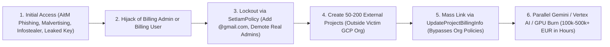

# Risk Analysis & Critical Review of Customer Mitigation Advisory

**References:** [Contexto.pdf](file:///Users/carmona/Agy/Caso%20Billling%20Admin/Contexto.pdf) · [CorreoMitigacionRiesgo.pdf](file:///Users/carmona/Agy/Caso%20Billling%20Admin/CorreoMitigacionRiesgo.pdf) · [PropuestaPartner.pdf](file:///Users/carmona/Agy/Caso%20Billling%20Admin/PropuestaPartner.pdf)

---

## 1. Threat Confirmation & Deep-Dive Risk Analysis

### 1.1 Confirming the Core Risk: Why `roles/billing.admin` Is an Existential Financial Vector
Yes—compromise of an identity holding **Billing Account Administrator (`roles/billing.admin`)** represents one of the highest-impact financial risks in Google Cloud. Unlike traditional infrastructure compromises (which are bounded by a single project's quotas and Organization Policies), **a Billing Account compromise exploits the architectural decoupling between Google Cloud's Resource Hierarchy and its Financial Control Plane**.

In Google Cloud:
- **Projects inherit Organization Policies and Quotas from their parent Organization/Folder, NOT from their Billing Account.**
- **A Billing Account (`billingAccounts/*`) can pay for projects located in *any* external GCP Organization—or "No Organization" at all.**

Once an attacker controls `roles/billing.admin`, they execute a four-stage blitz ("LLMjacking" / cloud billing hijack):
1. **Administrative Lockout & Blindness (`cloud.billing.accounts.setIamPolicy`):** Assuming `constraints/iam.allowedPolicyMemberDomains` is absent on the organization parenting the Billing Account, the attacker adds disposable `@gmail.com` accounts as `roles/billing.admin` and strips or downgrades legitimate corporate admins to `roles/viewer` (or removes them completely). The victim loses access to Cloud Billing consoles, cost dashboards, unlink controls, and billing support cases.
2. **Total Organization Policy Bypass:** The attacker creates dozens or hundreds of external **Made-for-Abuse** projects outside the victim's GCP Organization (where the attacker is `roles/owner`) and links them to the hijacked Billing Account (`projects.updateBillingInfo`). Every guardrail inside the customer's Organization (`restrictServiceUsage`, VPC Service Controls, SCC detectors, internal quotas) is completely bypassed.
3. **Horizontal Quota Multiplication:** Even though Google enforces per-project rate and spend quotas on Gemini API, Vertex AI, and Compute Engine GPUs, linking **100 external projects multiplies per-project quotas by 100x instantaneously**. Attackers monetize this within minutes by reselling reverse-proxied LLM API access (Claude/Gemini on Vertex AI or AI Studio) on underground markets or running GPU cryptomining.
4. **Zero Financial Recovery (Shared Responsibility Reality):** Because initial entry occurs via stolen customer credentials, session cookies, or leaked keys rather than a Google platform vulnerability, corporate and indirect/reseller accounts routinely face **0% credit/waiver** from Google Support.

---

### 1.2 Four Additional High-Severity Risks Often Overlooked

> [!CAUTION]
> Focusing exclusively on `roles/billing.admin` leaves major parallel attack paths open—especially in Partner/Reseller environments.

| Risk Vector | Why It Is Dangerous | Blast Radius |
| :--- | :--- | :--- |
| **1. Standing `roles/billing.user` (`Billing Account User`)** | Many teams strip `billing.admin` but leave `roles/billing.user` on developers, Org Admins, or CI/CD Service Accounts so they can create projects. While `billing.user` **cannot** lock out admins (`SetIamPolicy`), it **does** hold `billing.resourceAssociations.create`. A compromised developer or Terraform SA can still link **hundreds of external Made-for-Abuse projects** to the corporate Billing Account and burn €200k overnight before anyone notices. *(This directly validates the Partner's concern in [PropuestaPartner.pdf](file:///Users/carmona/Agy/Caso%20Billling%20Admin/PropuestaPartner.pdf).)* | Unbounded financial drain across external projects (without IAM lockout). |
| **2. Partner / Reseller Subaccount Amplification & Cross-Org Blind Spot** | In a Partner/Reseller model, Billing Subaccounts live under the **Partner's GCP Organization**, not the customer's Organization.  • If a customer enables `allowedPolicyMemberDomains` in *their* Organization, **it does NOT protect a Billing Subaccount owned by the Partner's Organization**. • Conversely, Partners often relax `allowedPolicyMemberDomains` on their billing org to grant customer emails access to subaccounts—inadvertently allowing `@gmail.com` escalation. • Compromising a single Partner operator with parent `billing.admin` compromises **every customer subaccount simultaneously**, and the **Partner bears wholesale payment liability to Google**. | Multi-customer catastrophic financial & contractual exposure for the Partner. |
| **3. Workspace Super Admin / `orgpolicy.policyAdmin` Lateral Takeover** | Even if `roles/billing.admin` is isolated in a break-glass user, a compromised **Google Workspace Super Admin** can reset the break-glass user's password/2SV, move them out of the FIDO2 Organizational Unit, disable Context-Aware Access, and assign themselves `roles/orgpolicy.policyAdmin` + `roles/billing.admin` to delete `allowedPolicyMemberDomains` and hijack billing. | Full tenant & billing takeover despite role separation. |
| **4. Vertex AI Model Garden & Cloud Marketplace Procurement Abuse** | Attackers don't just consume Gemini API (`generativelanguage.googleapis.com`). With `roles/billing.admin` (or `roles/consumerprocurement.orderAdmin`), attackers enable **Vertex AI Model Garden** (burning premium partner LLMs like Anthropic Claude / Llama at massive token rates) or purchase expensive third-party SaaS/AI commitments via **Google Cloud Marketplace** (`cloudcommerceprocurement.googleapis.com`). | Massive non-refundable third-party Marketplace & LLM charges in minutes. |

---

## 2. Critical Review & Challenge of `CorreoMitigacionRiesgo.pdf`

### Overall Assessment
[CorreoMitigacionRiesgo.pdf](file:///Users/carmona/Agy/Caso%20Billling%20Admin/CorreoMitigacionRiesgo.pdf) is **significantly stronger than standard industry advisories**—particularly in calling out AitM reverse-proxy MFA downgrades, requiring strict `"Only security keys"` (FIDO2), recommending Google Advanced Protection Program (APP), Context-Aware Access (CAA), Privileged Access Manager (PAM), and Cloud Audit Log alerts on `SetIamPolicy` / `UpdateProjectBillingInfo`.

However, if a customer follows this email literally, **8 critical security and operational gaps remain**:

### 2.1 Detailed Challenge Matrix

| # | Section in Email | What Is Missing, Misleading, or Dangerous | Recommended Correction / Addition |
| :- | :--- | :--- | :--- |
| **1** | **Sec. 1: Spend Caps (Gemini API)** | **False sense of security on Spend Caps:** Native Cloud Billing Spend Caps apply **per-project and per-eligible-service** (e.g., `generativelanguage.googleapis.com`). They **do NOT cap total Billing Account spend**, **do NOT apply to newly linked external attacker projects**, and **do NOT natively auto-pause Compute Engine GPUs or all Vertex AI Model Garden workloads**. Customers reading Section 1 may believe enabling a Spend Cap protects their Billing Account from hijack. | Explicitly warn that **Spend Caps only protect individual known projects**, NOT the Billing Account against external project linking, and do not cover all Vertex AI / Compute SKUs. Recommend a programmatic **Budget/Monitoring Kill-Switch** for non-capped services. |
| **2** | **Sec. 1 & 3: Budget & Audit Log Alerts** | **Passive human alerts vs. machine-speed attacks:** Automated abuse scripts link 100+ projects and burn €50k+/hour at 03:00 AM on weekends. Email alerts (especially Billing Budgets, which suffer multi-hour billing pipeline latency) arrive after massive damage is done. | Upgrade from *passive alerting* to **automated active remediation**: route real-time `UpdateProjectBillingInfo` Admin Activity logs via Eventarc/PubSub to a Cloud Run function that checks `projects.getAncestry` and **immediately unlinks (`billingAccountName=""`) any project outside the approved Organization ID(s)** within seconds. |
| **3** | **Sec. 2 & 3: Reseller / Partner Model Ambiguity** | **Who owns the Billing Account?** You sent this email to both direct customers and indirect/partner customers. Indirect customers **do not own the parent Organization of their Reseller Billing Subaccount**—so enabling `allowedPolicyMemberDomains` in the *customer's* Org does **not** block `@gmail.com` admins on a Partner-hosted subaccount, nor can customers set Billing-level Audit Sinks on Partner accounts. | Split Section 3 actions clearly between **Direct Billing Customers** and **Partner-Managed / Resold Customers** (instructing indirect customers to request revocation of standing `billing.user`/`billing.admin` from their Partner and adopt brokered project linking). |
| **4** | **Sec. 4: Browser Isolation & Session Control** | **`gcloud` CLI & ADC local token blind spot:** A clean Chrome profile stops malicious browser extensions, but infostealers on developer/admin laptops actively harvest **`~/.config/gcloud/credentials.db`** and **`application_default_credentials.json`**, which hold long-lived OAuth tokens outside the browser. | Explicitly instruct admins: **Never run `gcloud auth login` or `gcloud auth application-default login` on local laptops using privileged Org/Billing identities.** Use ephemeral Cloud Shell or short-lived Service Account impersonation, and ensure CAA policies apply to **Cloud APIs / CLI** (`gcloud`), not just Console web UI. |
| **5** | **Sec. 2: Organization Policies** | **Missing 3 essential companion constraints:** 1. `disableServiceAccountKeyCreation` does NOT block **`constraints/iam.disableServiceAccountKeyUpload`** (attackers generate RSA keys locally and upload the public key for backdoor persistence!). 2. Missing **`constraints/resourcemanager.allowedExportDestinations`** (stops attackers from migrating an internal project out of the Org to strip policies while keeping its billing link). 3. Default **`roles/resourcemanager.projectCreator`** is granted to the entire corporate domain at Org creation, letting any phished employee spin up shadow projects. | Add `constraints/iam.disableServiceAccountKeyUpload`, `constraints/resourcemanager.allowedExportDestinations`, `cloudcommerceprocurement.googleapis.com` (in `restrictServiceUsage` to block Marketplace abuse), and revoke domain-wide `roles/resourcemanager.projectCreator`. |
| **6** | **Sec. 3 & 4: Break-Glass & Workspace OU** | **Single Workspace Super Admin SPOF:** If an attacker steals one Super Admin session cookie before CAA is airtight, that Super Admin can disable CAA, remove the `"Only security keys"` OU enforcement, or reset internal break-glass credentials. | Recommend enabling **Google Workspace Multi-Party Approval (MPA)** for sensitive admin actions (2SV changes, CAA changes, Super Admin grants) and storing 2 physical FIDO2 keys for break-glass accounts offline with instant SIEM alerting on any break-glass sign-in. |
| **7** | **Sec. 2: "Policies Are Non-Retroactive"** | **The Non-Retroactivity Trap:** Emphasizing that Org Policies won't break existing workloads reassures ops teams, but hides a critical danger: **existing `@gmail.com` principals, already-enabled Vertex/Gemini APIs in idle projects, and existing unrestricted `AIza...` keys remain 100% active and exploitable!** | Add a mandatory **"Day-1 Hygiene Sequence"** right after enabling Org Policies: (1) audit & remove external principals on Org + Billing IAM, (2) disable `aiplatform.googleapis.com` & `generativelanguage.googleapis.com` in projects that don't use them, (3) delete/rotate legacy SA & API keys. |
| **8** | **Sec. 3: Cloud Audit Log Routing** | **Audit Log Visibility Loss on Lockout:** If logs are only viewed inside the Console and not exported via an **Organization-level Aggregated Sink** to an isolated, immutable Security Project / external SIEM, billing lockout or project deletion can disrupt responder triage—and remember that **Billing Account Admin Activity logs are emitted in the Organization that owns the Billing Account**, not inside linked projects! | Specify configuring an **Organization-level Aggregated Log Sink** (on the Organization owning the Billing Account) + configuring **Essential Contacts (`essentialcontacts.googleapis.com`)** pointing to a security distribution list outside individual user inboxes. |

---

### 2.2 Ready-to-Insert Addendum (EN / ES) for Future Customer & Partner Communications

> [!TIP]
> You can append or fold these concise callouts into v2 of `CorreoMitigacionRiesgo.pdf` without rewriting the entire email:

- **English Callout (Clarifying Spend Caps & Partner Subaccounts):**
  > **Important limitations to keep in mind:**
  > - *Spend Caps are project-specific:* Gemini Spend Caps only pause traffic on the specific project where they are configured; they **do not** block charges if an attacker with `billing.admin` or `billing.user` links new external projects to your Billing Account, nor do they pause Compute Engine GPUs or all Vertex AI Model Garden models. Removing standing `billing.admin` and `billing.user` roles is mandatory.
  > - *Additional Policies & CLI Hygiene:* Also enforce `constraints/iam.disableServiceAccountKeyUpload`, restrict `cloudcommerceprocurement.googleapis.com` (Marketplace), remove domain-wide `Project Creator` permissions, enable Workspace **Multi-Party Approval**, and never store privileged admin sessions locally via `gcloud auth login` on endpoints.
  > - *Using a Partner/Reseller Billing Subaccount?* Organization Policies in your GCP Organization do not govern a Partner-owned Billing Account. Contact us so we can remove standing `billing.user` grants on your subaccount and transition your project linking to a secure, validated workflow.

- **Spanish Callout (Aclaración sobre Spend Caps y Subcuentas de Partner):**
  > **Limitaciones críticas a tener en cuenta:**
  > - *Los Spend Caps aplican solo por proyecto individual:* Los límites de gasto de Gemini solo pausan el proyecto donde se configuran; **no detienen el gasto** si un atacante con `billing.admin` o `billing.user` vincula proyectos externos nuevos a tu Cuenta de Facturación, ni bloquean GPUs en Compute Engine o todos los modelos de Vertex AI Model Garden. Es imprescindible eliminar los permisos permanentes de `billing.admin` y `billing.user`.
  > - *Políticas adicionales e higiene en CLI:* Activa también `constraints/iam.disableServiceAccountKeyUpload`, restringe `cloudcommerceprocurement.googleapis.com` (Marketplace), elimina el rol `Project Creator` asignado a todo el dominio, habilita **Aprobación Múltiple (Multi-Party Approval)** en Workspace y nunca ejecutes `gcloud auth login` con cuentas privilegiadas en portátiles.
  > - *¿Usas una subcuenta de facturación gestionada por Partner/Reseller?* Las Políticas de Organización de tu propio GCP no protegen una Cuenta de Facturación alojada en la organización del Partner. Contáctanos para revocar los roles permanentes de `billing.user` y pasar a un flujo validado y automatizado de vinculación de proyectos.
